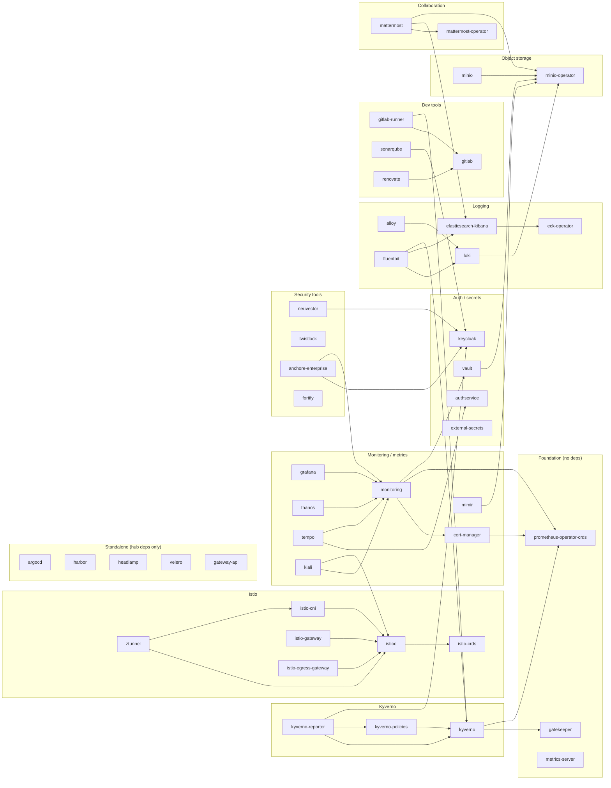

# Big Bang HelmRelease dependency graph

Extracted from `dependsOn` in `bigbang/chart/templates/*/helmrelease.yaml`.

Conventions:

- `A --> B` means **A depends on B** (B deploys first).
- Many edges are conditional (only rendered when both packages are enabled);
  this graph shows the union of all possible edges.
- **Omitted for readability:** nearly every package also depends on the four
  hubs `gatekeeper`, `kyverno-policies`, `istiod` (+`istio-cni` when enabled,
  via the `istioHelmReleases` helper), and `monitoring`. Only distinctive
  edges are drawn.

## Hub dependencies (omitted above)

| Hub | Depended on by |
|---|---|
| `gatekeeper` | everything (when enabled) |
| `kyverno-policies` | everything (when enabled) |
| `istiod` + `istio-cni` | everything mesh-injected, via `istioHelmReleases` |
| `monitoring` | everything that ships metrics/dashboards |
